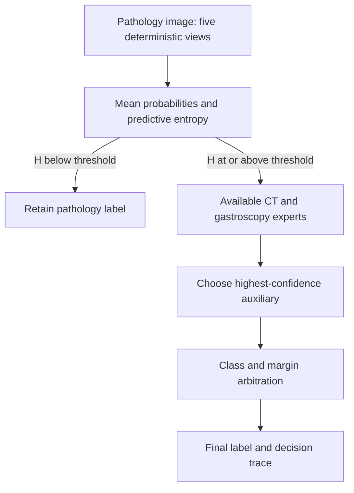

# UAMF-Net

**Uncertainty-aware, pathology-guided multimodal decision fusion.**

UAMF-Net combines a pathology classifier with selectively invoked CT and
gastroscopy classifiers. Five pathology views produce an averaged probability
vector. Its predictive entropy controls auxiliary inference; class-dependent
confidence and margin rules determine whether an auxiliary prediction changes
the pathology label.

This repository provides a research reference implementation and a synthetic
demonstration of the decision procedure. Clinical images, patient manifests,
and trained task checkpoints are not distributed. The public implementation is
not an archived snapshot of the original experimental runs; the synthetic demo
does not reproduce or substantiate the manuscript's performance results.

## Quick start: no patient data or model downloads

From the repository root, using Python 3.10 or newer:

```bash
python -m uamf_net demo
python -m unittest discover -s tests -v
```

The demo uses six hand-constructed probability examples: a low-entropy decision,
a CT-supported recall override, a gastroscopy-supported benign override,
an insufficient margin, absent auxiliary inputs, and a confidence tie. It
exercises routing and arbitration without importing PyTorch. It has no reference
diagnoses and reports no clinical accuracy or F1 score.

```bash
python -m uamf_net demo --output outputs/demo.json
```

## Method



| Component | Reference implementation |
| --- | --- |
| Pathology expert | `convnext_base.fb_in1k`, 224 × 224 inputs |
| CT expert | `maxvit_tiny_tf_512.in1k`, 512 × 512 **2D** inputs |
| Gastroscopy expert | `fastvit_ma36.apple_in1k`, 224 × 224 inputs |
| Pathology TTA | Original crop, horizontal flip, vertical flip, 90° rotation, enlarged center crop |
| Auxiliary inference | One center-cropped view per available expert |
| Uncertainty | Entropy of the mean softmax vector, using natural logarithms |
| Auxiliary selection | Highest maximum class probability; CT wins an exact tie by default |
| Fusion | Explicit decision-level rules; no trainable fusion head |
| Training | Separate classifier-head training by default; full fine-tuning is configurable |
| Loss | Poly-1 cross-entropy, ε = 1.0; standard cross-entropy is configurable |

The implementation uses sequential forwards for pathology TTA. Auxiliary models
are loaded on first use. Neither parallel execution nor a measured memory or
latency improvement is asserted here.

The class order is `0: tubular carcinoma`, `1: poorly cohesive carcinoma`,
`2: benign`. The exact class definitions must match the private annotations.
See [the decision rules](docs/METHOD.md) for equations, boundary conditions,
missing-modality behavior, and the map from method components to source files.

## Install image-model dependencies

Install a mutually compatible `torch` and `torchvision` build for the intended
CPU or CUDA environment, then install the remaining requirements:

```bash
python -m pip install -r requirements.txt
```

Pretrained initialization is requested from `timm` during training. Evaluation
loads only locally supplied task checkpoints. A missing or incompatible
checkpoint is an error; inference never silently falls back to random weights.
The dependency ranges are compatibility requirements, not a claim that every
listed version combination has been tested.

## Private-data interface

Use one local CSV manifest to specify pairing and patient-disjoint splits.
The supplied [example manifest](examples/manifest.example.csv) illustrates the
schema with fictional IDs and nonexistent image paths; it is not a dataset.

| Column | Meaning |
| --- | --- |
| `sample_id` | Unique pathology-image record ID |
| `patient_id` | Local patient identifier, used for split validation |
| `split` | `train`, `val`, or `test` |
| `label` | Integer class, 0–2 |
| `pathology` | Required RGB image path |
| `ct` | Paired 2D CT image path, or an empty field |
| `gastro` | Paired gastroscopy image path, or an empty field |

Relative image paths are resolved against `--data-root`. The manifest explicitly
selects the paired auxiliary images; filenames are never searched by prefix.
One auxiliary image may be shared by several pathology patches from the same
patient. It is deduplicated for independent expert training. Multiple frames or
slices must be selected externally using a documented acquisition protocol.

The loader rejects patients appearing in multiple splits, images reused across
patients or splits, repeated pathology images, conflicting patient labels, and
missing declared files. An empty auxiliary field means unavailable. A path to a
missing or corrupt file is an error, rather than an undocumented missing input.

```bash
# Schema and pairing checks on the fictional template; no images are opened.
python -m uamf_net validate-manifest \
  --manifest examples/manifest.example.csv --data-root . --schema-only

# Checks on a private manifest, including local file existence.
python -m uamf_net validate-manifest \
  --manifest /private/manifest.csv --data-root /private/images
```

Clinical acquisition, WSI patch extraction, stain processing, CT windowing and
slice selection, and gastroscopy frame selection are external to this package.
The code consumes the resulting 2D RGB images. It does not implement a 3D CT
encoder or whole-slide aggregation.

## Train the experts

All parameters are explicit in [configs/reference.json](configs/reference.json).
The reference configuration uses Poly-1 loss, AdamW, classifier-head training,
and validation-loss selection with a maximum of 20 epochs and patience of 5.
These are configurable reference settings, not recovered experiment logs.

```bash
python -m uamf_net train \
  --config configs/reference.json \
  --manifest /private/manifest.csv --data-root /private/images \
  --checkpoint-dir checkpoints/run_001 --modality all --device auto
```

Each modality requires nonempty training and validation subsets. Training must
include all three classes. `head_only` trains the backbone's actual classifier
module while keeping the frozen backbone in evaluation mode. `full` optimizes
all parameters. Mixed precision is enabled only on CUDA, with gradient scaling.

Training writes `pathology_best.pt`, `ct_best.pt`, and `gastro_best.pt`, together
with per-epoch loss histories. Checkpoints include model, class-order,
preprocessing, and training metadata. Existing task checkpoints are not
overwritten. Use a fresh directory for a new run.

## Fix thresholds on validation data, then evaluate

First collect validation traces. All available auxiliary experts are evaluated
on validation images so alternative policies can be compared without re-running
the encoders:

```bash
python -m uamf_net evaluate \
  --config configs/reference.json \
  --manifest /private/manifest.csv --data-root /private/images \
  --checkpoint-dir checkpoints/run_001 --split val \
  --output outputs/validation --device auto

python -m uamf_net tune \
  --config configs/reference.json \
  --predictions outputs/validation/predictions.jsonl \
  --output-config configs/local_selected.json \
  --report outputs/validation/threshold_search.json
```

`tune` accepts validation traces only. It searches recall thresholds 0.50–0.90
and benign thresholds 0.60–0.95, each in steps of 0.05, while keeping the entropy
threshold and margin fixed. The objective is image-level accuracy; ties favor
fewer overrides, then higher thresholds. This command selects settings from its
input data; it contains no hard-coded experimental optimum.

Evaluate once using the fixed selected configuration. Test-time auxiliary
inference is entropy-gated:

```bash
python -m uamf_net evaluate \
  --config configs/local_selected.json \
  --manifest /private/manifest.csv --data-root /private/images \
  --checkpoint-dir checkpoints/run_001 --split test \
  --output outputs/test --device auto
```

Evaluation saves a complete `predictions.jsonl`, `metrics.json`, and configuration
snapshot. Traces retain all records, including unchanged decisions, with expert
probabilities, entropy, auxiliary source, margin, and arbitration reason.
Metrics include accuracy, per-class precision/recall/specificity/F1, macro-F1,
confusion matrices, corrected errors, harmful overrides, and net correct-count
change. CT and gastroscopy call/selection/contribution counts are separate.
Metrics are image-level; the number of distinct patients is reported separately.
An existing nonempty output directory is not overwritten.

## Repository layout

```text
UAMF-Net.py                 Compatibility CLI entry point
configs/reference.json     Explicit model, training, and policy settings
examples/manifest.example.csv
docs/METHOD.md             Method equations and implementation map
uamf_net/
  config.py                Configuration validation and serialization
  data.py                  Pairing, split validation, and deduplication
  models.py                Backbones, transforms, task checkpoint loading
  training.py              Independent expert training and validation
  fusion.py                Entropy gating and conditional arbitration
  pipeline.py              Image evaluation and complete trace export
  tuning.py                Validation-only threshold selection
  metrics.py               Classification and override accounting
  demo.py                  Synthetic probability examples
  cli.py                   Command-line interface
tests/test_reference.py    Synthetic logic and interface checks
```

## Availability and verification scope

Only source code, documentation, configuration, and fictional interface examples
are included. Keep clinical data, identifiers, local manifests, model weights,
and evaluation outputs outside version control. Project-specific exclusions are
included in `.gitignore`.

The dependency-free synthetic checks cover routing, missing modalities, strict
thresholds, confidence ties, patient/image split isolation, complete trace export,
override accounting, and validation-only threshold selection. They do not
validate clinical performance, GPU execution, backbone compatibility in every
environment, or manuscript-reported accuracy, memory, or latency. Image training
and evaluation require the private dataset and matching task checkpoints.
